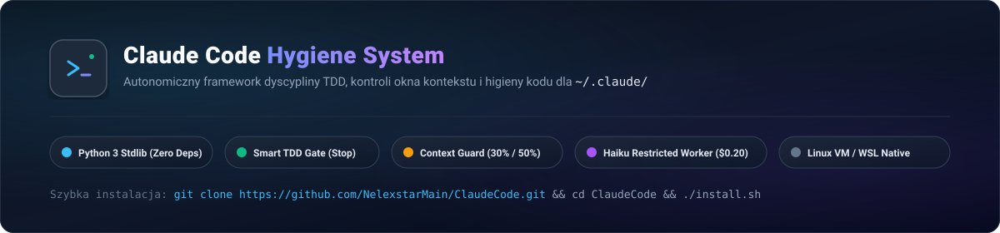
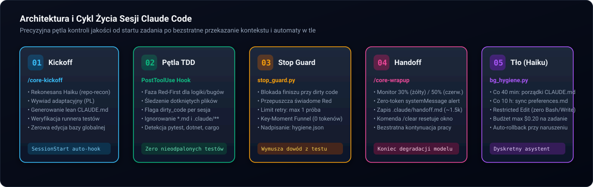
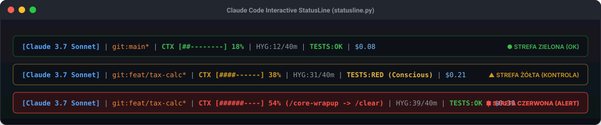
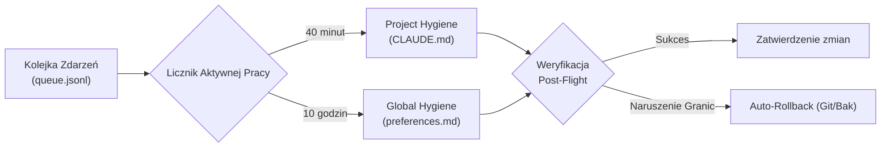

<p align="center">
  
</p>

<p align="center">
  <a href="#-szybki-start-i-instalacja"></a>
  <a href="#-architektura-i-za%C5%82o%C5%BCenia"></a>
  <a href="#-smart-tdd-gate-stop_guardpy"></a>
  <a href="#-monitor-kontekstu-i-statusline"></a>
  <a href="#-automaty-w-tle-haiku-restricted-edit"></a>
  <a href="#-testy-jednostkowe"></a>
</p>

---

## 🧭 Czym jest Claude Code Hygiene System?

**Claude Code Hygiene System** to kompletny, produkcyjny zestaw reguł, skryptów hooków oraz dedykowanych skilli dla [Claude Code](https://code.claude.com/docs/). Został zaprojektowany dla środowisk **Linux VM** oraz **WSL2** z myślą o wyeliminowaniu trzech najczęstszych problemów podczas wielogodzinnej pracy z modelami LLM w terminalu:

1. **Halucynacje i brak weryfikacji zmian:** Agent twierdzi, że kod działa, ale nie uruchomił testów ani kompilacji po edycji plików.
2. **Degradacja uwagi przy przepełnieniu kontekstu:** Model zaczyna gubić instrukcje i generować błędy powyżej 50% pojemności okna kontekstowego (200k).
3. **Zaśmiecanie repozytorium:** Narastające tymczasowe pliki `CLAUDE.md`, martwy kod, rozrastające się instrukcje i wycieki zmiennych środowiskowych.

Całość opiera się na **czystej bibliotece standardowej Pythona 3** (`fcntl`, `subprocess`, `json`, `pathlib`) — **zero zewnętrznych zależności pip**, natychmiastowe uruchomienie w ułamku milisekundy i pełna izolacja.

---

## ⚡ Szybki Start i Instalacja

### Wymagania wstępne
- **OS:** Linux (Ubuntu/Debian/Fedora/Arch) lub Windows z WSL2 / macOS
- **Narzędzia:** Python 3.10+ zainstalowany w `$PATH`, Git, zainstalowane oficjalne CLI `claude`

### Instalacja w 1 krok

```bash
# Sklonuj repozytorium
git clone https://github.com/NelexstarMain/ClaudeCode.git
cd ClaudeCode

# Nadaj uprawnienia i uruchom instalator
chmod +x install.sh
./install.sh
```

Instalator [install.sh](install.sh) automatycznie:
1. Uruchamia pełny zestaw testów regresyjnych (`python3 -m unittest discover -s tests -v`).
2. Tworzy automatyczny snapshot istniejącej konfiguracji w `~/.claude/backups/YYYYMMDD_HHMMSS/`.
3. Kopiuje konfigurację [.claude/](.claude/) do `~/.claude/` z zachowaniem atomowości.
4. Nadaje prawa wykonywalności (`chmod +x`) wszystkim skryptom hooków w `~/.claude/hooks/`.

> **Alternatywa manualna (bez backupu):**
> ```bash
> cp -r .claude ~/.claude && chmod +x ~/.claude/hooks/*.py
> ```

---

## 🏗️ Architektura i Przepływ Sesji

Poniższy diagram ilustruje pełną pętlę kontroli jakości realizowaną przez zestaw hooków Claude Code:

<p align="center">
  
</p>

### Zestawienie Hooków i Ich Role

| Zdarzenie CLI | Skrypt Hooka | Tryb | Zadanie i Działanie |
|---|---|---|---|
| `SessionStart` | `session_start.py` | Sync (10s) | Wstrzykuje `.claude/handoff.md` do nowej sesji, archiwizuje stan do `.claude/handoff.consumed.md`. |
| `UserPromptSubmit` | `prompt_submit.py` | Sync (10s) | Weryfikuje intencję promptu, rejestruje czas rozpoczęcia tury, resetuje licznik retry TDD. |
| `PostToolUse` | `post_tool.py` | Sync (10s) | Oznacza flagę `code_dirty` po edycji kodu produkcyjnego (`Edit`/`Write`). Wykrywa i rejestruje wywołania testów (`Bash`). |
| `SubagentStart/Stop` | `subagent_track.py` | Async (10s) | Monitoruje liczbę aktywnych agentów potomnych, chroni główny kontekst przed hałasem. |
| `PreCompact` | `pre_compact.py` | Sync (10s) | Wywoływany przed kompresją historii; ostrzega przed utratą nieutrwalonych decyzji. |
| `Stop` | `stop_guard.py` | Sync (15s) | **Smart TDD Gate:** Blokuje zakończenie tury bez testów. Przesyła metryki do kolejki Haiku. Wysyła alert 50% CTX. |
| `statusLine` | `statusline.py` | Live Widget | Generuje interaktywny pasek statusu w terminalu w czasie rzeczywistym. |

---

## 🚦 Smart TDD Gate (`stop_guard.py`)

Hook `Stop` działa jako strażnik dyscypliny inżynierskiej. Jeśli model zmodyfikował pliki produkcyjne, nie może zakończyć tury bez dowodu z uruchomionych testów lub kompilacji.

<p align="center">
  
</p>

### Reguły Działania Strażnika:
1. **Ignorowanie plików pomocniczych:** Modyfikacje dokumentacji (`*.md`, `*.txt`), konfiguracji (`.claude/**`, `.gitignore`) czy licencji **nie** aktywują blokady testów.
2. **Świadoma Faza Red (Conscious Red Phase):** Jeśli w cyklu TDD agent napisał test, uruchomił go i test zakończył się niepowodzeniem (zgodnie z założeniem Red), statusline przełącza się w stan `TESTS:RED`, a hook `Stop` **nie blokuje** odpowiedzi. Pozwala to agentowi zaprezentować użytkownikowi plan implementacji.
3. **Automatyczne rozpoznawanie narzędzi testowych:**
   - C# / .NET: `dotnet test`, `dotnet build`
   - Python: `pytest`, `python -m unittest`, `uv run pytest`, `poetry run pytest`
   - Node / Web: `npm test`, `pnpm test`, `yarn test`, `vitest`, `jest`
   - Rust: `cargo test`
   - Go: `go test`
   - Kontenery / Skrypty: `docker compose exec ...`, `make test`, `./scripts/verify.sh`
4. **Ograniczenie pętli (Circuit Breaker):** Limit retry wynosi `STOP_RETRY_CAP = 1`. Model ma dokładnie jedną szansę na uruchomienie testów po zwróceniu decyzji blokującej, co zapobiega zacięciu w nieskończonej pętli.

---

## 📊 Monitor Kontekstu i Pasek Stanu (`statusline.py`)

Pasek statusu wyświetla kluczowe metryki sesji bez zużywania ani jednego tokena:

```text
[Claude 3.7 Sonnet] | git:main* | CTX [###-------] 34% | HYG:18/40m | TESTS:OK | $0.14
```

### Progi Kontroli Kontekstu:
- 🟢 **Strefa Zielona (< 30%):** Bezpieczna praca. Model dysponuje pełną uwagą (attention) i nie gubi szczegółów.
- 🟡 **Strefa Żółta (30% – 50%):** Pasek zmienia kolor na żółty. Należy domknąć bieżące zadanie i unikać wstrzykiwania do sesji wielkich plików logów.
- 🔴 **Strefa Czerwona (≥ 50%):** Pasek staje się czerwony, a w terminalu pojawia się wezwanie do zakończenia etapu:
  ```text
  [Hygiene] Context window at 54% (>= 50%). Finish your current milestone, run /core-wrapup, and reset with /clear.
  ```
  Na tym etapie należy wpisać `/core-wrapup` (co generuje gęsty, techniczny dokument `.claude/handoff.md`), a następnie zresetować sesję komendą `/clear`. Nowa sesja natychmiast załaduje kontekst bez utraty ustaleń architektonicznych.

---

## 🤖 Automaty w Tle: Haiku Restricted Edit (`bg_hygiene.py`)

W tle działa niewidoczny proces sprzątający zasilany przez model **Claude 3.5 Haiku**:



### Mechanizmy Bezpieczeństwa:
- **Sandbox narzędziowy:** Dostępne wyłącznie `Read`, `Glob`, `Grep`, `Edit`. Narzędzia `Bash`, `Write`, `NotebookEdit`, dostęp do internetu oraz subagenci są **twardo zablokowane**.
- **Twardy limit budżetu:** `--max-budget-usd 0.20` oraz `--max-turns 4`.
- **Ścisłe granice w plikach:**
  - W projekcie edytowana może być **wyłącznie** zawartość pomiędzy znacznikami:
    ```markdown
    <!-- HYGIENE:AUTO -->
    ...tylko ta sekcja podlega automatycznemu czyszczeniu...
    <!-- /HYGIENE:AUTO -->
    ```
  - Jakakolwiek modyfikacja poza znacznikami lub przekroczenie limitu 60 linii powoduje **natychmiastowy rollback** z kopii zapasowej.
- **Weryfikacja Git:** Przed uruchomieniem robota robiony jest snapshot `git status --porcelain`. Jeśli robot dotknie jakiegokolwiek innego pliku niż `CLAUDE.md` lub `.claude/hygiene-report.md`, zmiany są odrzucane.
- **Konsolidacja preferencji (10h):** Globalny plik `~/.claude/preferences.md` ma narzucony twardy limit **70 linii**, zapobiegający niekontrolowanemu rozrostowi reguł.

---

## ⚙️ Nadpisania per-Projekt (`.claude/hygiene.json`)

Każde repozytorium może dostosować zachowanie systemu bez ingerencji w globalne pliki w `~/.claude/`. Wystarczy utworzyć w katalogu projektu opcjonalny plik `.claude/hygiene.json`:

```json
{
  "extra_test_commands": [
    "./scripts/run-all-tests.sh",
    "tox -e py312",
    "cargo test --workspace"
  ],
  "extra_ignored_paths": [
    "database/seeds/**",
    "docs/diagrams/*.png",
    "*.generated.cs"
  ],
  "disable_tdd_gate": false
}
```

### Opcje Konfiguracyjne:
- `extra_test_commands`: Tablica niestandardowych komend, których wykonanie zdejmuje flagę `code_dirty` i zaspokaja strażnika `Stop`.
- `extra_ignored_paths`: Wzorce glob dla plików, których edycja nie powinna traktować projektu jako "brudnego kodu" (np. skrypty migracji SQL, pliki graficzne, generatory).
- `disable_tdd_gate`: Wartość `true` całkowicie wyłącza bramkę TDD (rekomendowane wyłącznie dla repozytoriów czysto dokumentacyjnych, infrastruktury Terraform lub prototypów UI).

---

## 🧰 Dedykowane Skille Przepływu Pracy

System dostarcza 6 wyspecjalizowanych skilli:

| Skill | Wywołanie | Przeznaczenie |
|---|---|---|
| **Core Kickoff** | `/core-kickoff` | Rytuał startowy: wywiad adaptacyjny po polsku, lekki rekonesans Haiku (`repo-recon`), generowanie lean `CLAUDE.md`. |
| **Core Wrapup** | `/core-wrapup` | Zamykanie etapu: sprawdzenie czystości kodu, uruchomienie testów, wygenerowanie zwięzłego `.claude/handoff.md` (~1500 tokenów). |
| **Core Tests** | `/core-tests` | Automatyczne wykrycie runnera testów w projekcie i uruchomienie minimalnego zestawu weryfikacyjnego. |
| **Core Memory** | `/core-memory` | Trzypoziomowe zarządzanie wiedzą: globalne preferencje, lokalne reguły projektu, stan aktywny sesji. |
| **Core Subagents** | `/core-subagents` | Wzorzec delegowania ciężkich zadań eksploracyjnych i parsowania wielkich logów do odizolowanych agentów potomnych. |
| **Core Hygiene** | `/core-hygiene` | Ręczne wymuszenie inspekcji stanu repozytorium, poszukiwanie martwego kodu i generowanie raportu. |
| **C# / .NET** | `/csharp` | Baza wiedzy dla ekosystemu .NET: Blazor, WPF, MAUI, EF Core, optymalizacja alokacji, `CancellationToken` i architektura async. |

---

## 📂 Struktura Repozytorium

```text
ClaudeCode/
├── .claude/                             # Główny katalog konfiguracyjny (kopiowany do ~/.claude/)
│   ├── CLAUDE.md                        # Globalne dyrektywy Claude (kontrakt językowy, zasady YAGNI)
│   ├── preferences.md                   # Globalne preferencje inżynierskie (maksymalnie 70 linii)
│   ├── settings.json                    # Rejestracja hooków, statusLine i timeoutów
│   ├── agents/                          # Definicje wyspecjalizowanych subagentów
│   │   └── repo-recon.md                # Lekki agent zwiadowczy do szybkiej analizy repozytorium
│   ├── hooks/                           # Skrypty hooków (czysty Python 3 stdlib)
│   │   ├── bg_hygiene.py                # Automatyczny worker Haiku w tle (cron 40m/10h)
│   │   ├── lib_hygiene.py               # Biblioteka współdzielona (tokeny, blokady, detekcja)
│   │   ├── post_tool.py                 # Oznaczanie dirty code i rejestracja wykonanych testów
│   │   ├── pre_compact.py               # Ochrona przed niekontrolowaną kompresją kontekstu
│   │   ├── prompt_submit.py             # Walidacja promptu i licznik czasu tury
│   │   ├── session_start.py             # Automatyczne wstrzykiwanie handoff.md do nowej sesji
│   │   ├── statusline.py                # Rysowanie paska statusu w terminalu w czasie rzeczywistym
│   │   ├── stop_guard.py                # Strażnik Smart TDD Gate i kolejka metryk
│   │   └── subagent_track.py            # Monitorowanie wątków potomnych
│   ├── hygiene/                         # Szablony ustawień dla agenta Haiku
│   │   ├── haiku-global-settings.json   # Ograniczenia narzędziowe dla konsolidacji preferencji
│   │   └── haiku-project-settings.json  # Ograniczenia narzędziowe dla porządkowania projektu
│   ├── rules/                           # Uniwersalne reguły programistyczne
│   │   ├── 01-discipline.md             # Zasady YAGNI, myślenie przed edycją, czysty zakres zadań
│   │   ├── 02-tdd.md                    # Pragmatyczny TDD, weryfikacja po ostatniej edycji
│   │   └── 03-clean-repo.md             # Sprzątanie śmieci, ochrona sekretów, izolacja pamięci
│   └── skills/                          # Gotowe procedury /core-* oraz domena csharp
├── assets/                              # Wektory SVG (bannery, diagramy przepływu, podglądy)
├── tests/                               # Kompletny pakiet testów jednostkowych
│   └── test_hooks.py                    # Testy wszystkich mechanizmów hooków i przypadków brzegowych
├── .gitattributes                       # Wymuszenie zakończeń LF dla skryptów bash i python
├── .gitignore                           # Precyzyjne reguły ignorowania pamięci podręcznej i stanu
├── install.sh                           # Bezpieczny instalator ze sprawdzaniem testów i backupem
└── README.md                            # Niniejsza dokumentacja
```

---

## 🧪 Testy Jednostkowe

Pakiet testów weryfikuje poprawność wszystkich skryptów hooków w izolowanych środowiskach tymczasowych (testy blokad wielowątkowych, sprawdzanie progu kontekstu, detekcja runnerów testów, symulacja Git rollback przy błędach Haiku).

Aby uruchomić testy lokalnie w środowisku Linux/WSL:

```bash
python3 -m unittest discover -s tests -v
```

Przykładowy wynik:
```text
test_bg_hygiene_in_real_git_repo_with_untracked_claude_dir (test_hooks.HygieneHooksTest) ... ok
test_disable_tdd_gate_override_via_project_hygiene_json (test_hooks.HygieneHooksTest) ... ok
test_flock_and_atomic_json (test_hooks.HygieneHooksTest) ... ok
test_key_moment_funnel_and_project_hygiene (test_hooks.HygieneHooksTest) ... ok
test_session_start_consumes_handoff (test_hooks.HygieneHooksTest) ... ok
test_smart_tdd_gate_blocks_dirty_code_then_allows_conscious_red_and_stop_hook_active (test_hooks.HygieneHooksTest) ... ok
test_statusline_output_and_context_caching (test_hooks.HygieneHooksTest) ... ok
----------------------------------------------------------------------
Ran 7 tests in 4.120s

OK
```

---

## 📜 Licencja

Projekt udostępniany na licencji [MIT](LICENSE). Kod hooków i reguł można dowolnie adaptować i rozbudowywać we własnych konfiguracjach deweloperskich.
